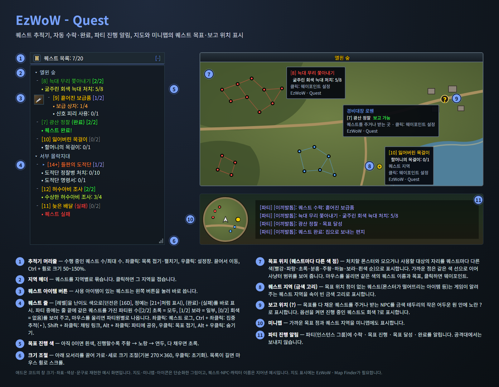
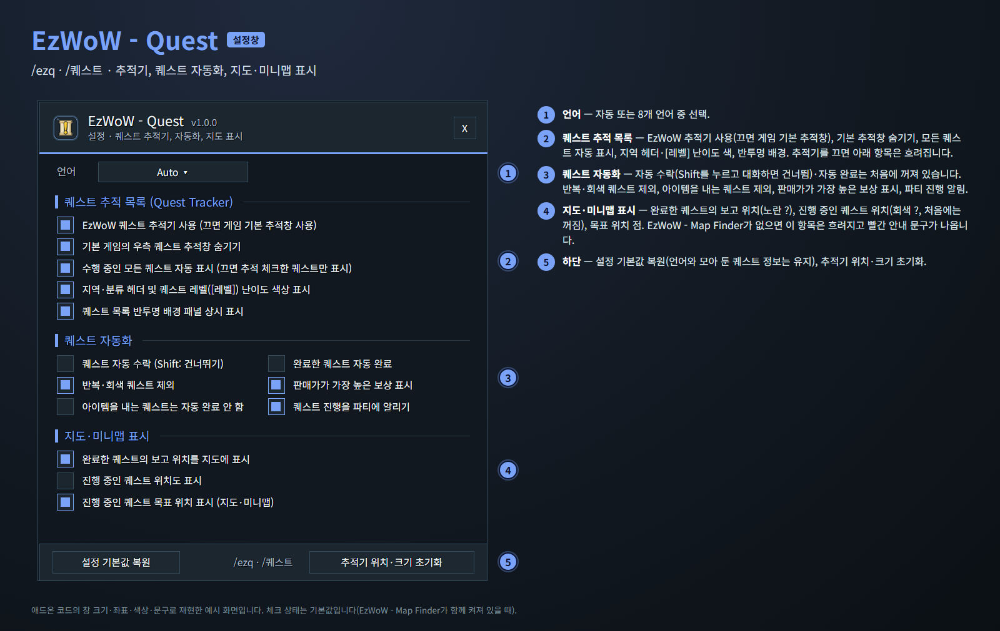
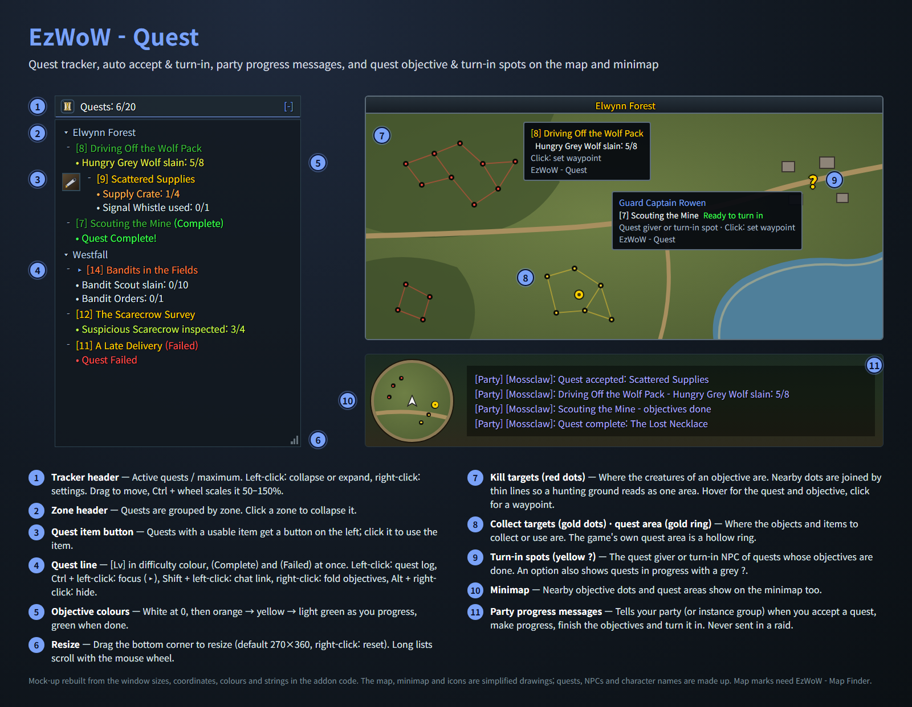
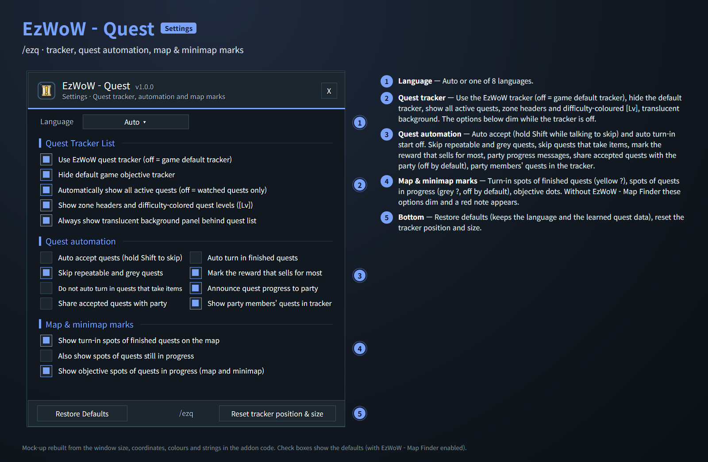

# EzWoW - Quest (`EzWoW-Quest`)

## CurseForge

- **Project ID / 프로젝트 ID:** `1787488`
- **Project page / 프로젝트 페이지:** [EzWoW-Quest](https://www.curseforge.com/wow/addons/ezwow-quest)

**[한국어](#한국어) · [English](#english)**

WoW Forever (`Interface: 16001`) · `/ezq` · `/퀘스트`

---

## 한국어

### 개요

퀘스트에 필요한 기능을 한곳에 모은 애드온입니다.

- 기본 추적창 대신 쓰는 **스크롤형 퀘스트 추적기** (지역별 묶음, `[레벨]` 난이도 색, 목표 진행 색, 퀘스트 아이템 버튼, 위치·크기 잠금, 글자만 보이는 투명 모드)
- 추적기에서 퀘스트를 클릭하면 **가장 가까운 수행 위치로 길 안내**
- **자동 수락·자동 완료** (Shift를 누르고 대화하면 건너뜀), 판매가가 가장 높은 보상 표시
- 수락·진행·완료를 파티에 알리는 **파티 진행 알림**
- **퀘스트 공유**(추적기에서 Alt + 좌클릭, 수락할 때 자동 공유 옵션)와 추적기의 **파티원 퀘스트 보유 표시**(`[2/4]`)
- **지도와 미니맵의 퀘스트 표시**: 퀘스트마다 다른 색의 목표 위치 점, 점이 없는 퀘스트의 퀘스트 지역(금색 고리), 보고 위치(`?`)
- 세계지도에 **지금 받을 수 있는 퀘스트를 주는 NPC**(노란 `!`), NPC와 미니맵 툴팁에 받을 퀘스트·보고할 퀘스트 표시
- 세계지도 퀘스트 목록의 **모두 펼치기/접기, 모두 체크/해제** 버튼

### 화면 미리보기

> 이미지는 애드온 코드의 창 크기·좌표·색상·문구로 재현한 **예시 화면**입니다. 지도·미니맵·아이콘은 단순화한 그림이고, 퀘스트·NPC·캐릭터 이름은 지어낸 예시입니다.

### 설치

1. `EzWoW-Quest` 폴더를 `Interface/AddOns/` 폴더에 넣습니다.
2. 캐릭터 선택 화면의 **애드온** 목록에서 켭니다.
3. 지도 표시를 쓰려면 **EzWoW - Map Finder**도 함께 켭니다.
4. 게임에서 `/ezq`(또는 `/퀘스트`)로 설정창을 엽니다.

### 기능 (위 그림의 번호)

| 번호 | 기능 | 설명 |
|---|---|---|
| ① | 추적기 머리줄 | 수행 중인 퀘스트 수/최대 수. 좌클릭: 목록 접기·펼치기, 우클릭: 설정창. 마우스를 올리면 자물쇠 버튼이 나옵니다(아래 참고) |
| ② | 지역 헤더 | 퀘스트를 지역별로 묶습니다. 클릭하면 그 지역을 접습니다 |
| ③ | 퀘스트 아이템 버튼 | 사용 아이템이 있는 퀘스트는 왼쪽 버튼을 눌러 바로 씁니다 |
| ④ | 퀘스트 줄 | `[레벨]`을 난이도 색으로(던전은 `[16D]`, 정예는 `[21+]`처럼 표시), `(완료)`·`(실패)`를 바로 표시합니다. 파티 중에는 줄 끝에 같은 퀘스트를 가진 파티원 수(`[2/2]` 초록 = 모두, `[1/2]` 보라 = 일부, `[0/2]` 회색 = 없음)를 보여 주고, 마우스를 올리면 파티원별로 나옵니다 |
| ⑤ | 목표 진행 색 | 0이면 흰색, 진행할수록 주황 → 노랑 → 연두, 다 채우면 초록. 새로 받은 퀘스트는 앞에 "NEW"가 붙고 마우스를 올리면 사라집니다 |
| ⑥ | 크기 조절 | 아래 모서리를 끌어 가로·세로 크기 조절(기본 270×360) |
| ⑦ | 목표 위치 (퀘스트마다 다른 색 점) | 처치할 몬스터와 모으거나 사용할 대상의 자리. 퀘스트마다 한 가지 색(빨강·파랑·초록·분홍·주황·하늘·보라·흰색 순)을 쓰고, 가까운 점은 같은 색 선으로 이어 사냥터 범위를 보여 줍니다. 툴팁의 퀘스트 이름도 같은 색입니다. 위치가 확실한 목표만 표시하고, 짐작한 위치는 표시하지 않습니다 |
| ⑧ | 퀘스트 지역 (금색 고리) | 목표 위치 점이 없는 퀘스트(몬스터가 떨어뜨리는 아이템 등)는 게임이 알려 주는 퀘스트 지역을 속이 빈 금색 고리로 표시 |
| ⑨ | 보고 위치 (`?`) | 목표를 다 채운 퀘스트를 주거나 받는 NPC. 금색 테두리의 작은 어두운 원 안에 노란 `?`. 옵션을 켜면 진행 중인 퀘스트도 회색 `?`로 표시 |
| ⑩ | 미니맵 | 가까운 목표 점과 퀘스트 지역을 미니맵에도 표시 |
| ⑪ | 파티 진행 알림 | 파티(인스턴스 그룹)에 수락·목표 진행·목표 달성·완료를 알림. 공격대에서는 보내지 않음 |
| ⑫ | 받을 수 있는 퀘스트 (`!`) | 지금 받을 수 있는 퀘스트가 있는 NPC를 세계지도에 금색 테두리의 작은 어두운 원 안에 노란 `!`로 표시. 마우스를 올리면 NPC 이름과 퀘스트 목록(`! [레벨] 퀘스트 이름`) |

지도의 점·물음표·느낌표에 마우스를 올리면 퀘스트와 목표가 나오고, 클릭하면 그 자리에 웨이포인트를 찍습니다.

#### 받을 수 있는 퀘스트 (`!`)

- 진영·직업·종족·전문 기술·레벨이 맞고, 앞 단계 퀘스트를 마친 퀘스트만 표시합니다. 이미 끝냈거나 퀘스트 목록에 있는 퀘스트는 빠집니다.
- 명절·이벤트·기부·전장 퀘스트와 너무 낮은 레벨(게임에서 회색으로 나오는) 퀘스트는 표시하지 않습니다.
- 퀘스트 레벨은 WoW Forever 서버 기준입니다.
- **NPC 툴팁과 미니맵 툴팁**에도 그 NPC에게서 받을 수 있는 퀘스트(노란 `!`, 몇 레벨 뒤에 받을 수 있는 퀘스트는 회색으로 "Lv.N부터")와 그 NPC에게 보고할 퀘스트(초록 `?`, "보고")가 나옵니다.

#### 알아낸 퀘스트 위치와 공유

- 퀘스트를 주고받는 NPC, 퀘스트 아이템이 나온 몬스터·오브젝트, 도착·정찰 목표를 마친 곳을 기억해서 지도에 보여 줍니다.
- 이 기록을 파티·길드와 이 애드온을 쓰는 다른 사람과 자동으로 공유합니다(애드온 메시지만 쓰고 채팅창에는 아무것도 나오지 않으며, 이름은 저장하지 않습니다). 공유 채널로 받은 퀘스트 NPC·몬스터 드롭은 여러 사람이 같은 내용을 보냈을 때 쓰고, 위치(정찰 지점, 오브젝트)는 받는 대로 씁니다.
- 이를 위해 숨은 채널에 들어갑니다. 내 채널 번호가 바뀌지 않도록 높은 번호(10번 이상)를 씁니다. 같은 채널 사람끼리는 채널 목록에서 캐릭터 이름이 보입니다.
- 설정에서 끌 수 있습니다("알아낸 퀘스트 위치를 다른 EzWoW 사용자와 공유").

#### 세계지도 퀘스트 목록

- 세계지도의 퀘스트 목록을 열면 지도 창 오른쪽 바깥에 버튼 두 개가 나옵니다.
- **모두 펼치기 / 모두 접기**: 퀘스트 목록의 모든 지역 머리줄을 한 번에 펼치거나 접습니다.
- **모두 체크 / 모두 해제**: 모든 퀘스트를 추적(체크)하거나, 모두 체크되어 있으면 모두 해제합니다.

#### 추적기 조작

| 조작 | 결과 |
|---|---|
| 머리줄 좌클릭 / 우클릭 | 목록 접기·펼치기 / 설정창 열기 |
| 퀘스트 좌클릭 | 퀘스트 로그를 열고 가장 가까운 수행 위치로 길 안내(채팅창에 목적지와 좌표를 알리고 웨이포인트를 찍음) |
| Ctrl + 좌클릭 | 퀘스트 로그만 열기 |
| Shift + 좌클릭 | 채팅창에 퀘스트 링크 / 추적 해제 |
| Alt + 좌클릭 | 파티에 퀘스트 공유 (공유할 수 없는 퀘스트는 채팅창에 짧게 알림) |
| 퀘스트 우클릭 | 목표 접기·펼치기 |
| Alt + 우클릭 | 목록에서 숨기기 |
| 끌기 | 추적기 이동 |
| Ctrl + 마우스 휠 | 크기 50~150% |
| 마우스 휠 | 긴 목록 스크롤 |
| 아래 모서리 끌기 / 우클릭 | 크기 조절 / 기본 크기(270×360) |
| Shift + 우클릭 | 위치 초기화 |
| Ctrl + 우클릭 | 크기(100%, 270×360) 초기화 |
| Ctrl + Alt + 우클릭 | 위치·크기 모두 초기화 |
| 머리줄의 자물쇠 버튼 | 위치·크기 잠금·해제. 잠기면 크기 조절과 Ctrl + 휠 배율이 막히고 배경이 투명해지며, Ctrl + 끌기로만 옮길 수 있습니다 |

- 길 안내는 아직 채우지 않은 목표의 위치 중 가장 가까운 곳을, 목표를 다 채운 퀘스트는 보고 위치를 가리킵니다. 안내할 곳이 없으면 퀘스트 로그만 엽니다.
- 전투 중에는 보호된 창 속성을 바꾸지 않습니다. 퀘스트 아이템 버튼은 전투가 끝난 뒤 갱신됩니다.

### 퀘스트 자동화

설정창의 **퀘스트 자동화** 항목에서 켭니다. NPC와 대화할 때 **Shift**를 누르고 있으면 그 대화에서는 자동화가 동작하지 않습니다.

| 항목 | 설명 | 기본값 |
|---|---|---|
| 퀘스트 자동 수락 | 퀘스트를 바로 수락합니다. 퀘스트가 없고 대화 선택지가 하나뿐인 NPC는 그 선택지를 고릅니다(귀환 장소 설정·초기화 같은 선택지는 제외). 일행이 공유한 퀘스트·호위 퀘스트 확인 창도 수락합니다. | 끔 |
| 완료한 퀘스트 자동 완료 | 목표를 다 채운 퀘스트를 바로 완료합니다. 보상을 골라야 하면 직접 고릅니다. 골드를 내는 퀘스트는 완료하지 않습니다. | 끔 |
| 반복·회색 퀘스트 제외 | 반복·일일 퀘스트와 레벨이 낮은 회색 퀘스트는 자동 수락하지 않습니다. | 켬 |
| 아이템을 내는 퀘스트는 자동 완료 안 함 | 아이템을 건네야 하는 퀘스트는 직접 완료합니다. | 끔 |
| 판매가가 가장 높은 보상 표시 | 보상을 고를 때 상점 판매가가 가장 높은 아이템에 금화 표시를 붙입니다. | 켬 |
| 퀘스트 진행을 파티에 알리기 | 파티(인스턴스 그룹)에 수락·목표 진행·목표 달성·완료를 알립니다. 공격대에서는 보내지 않습니다. | 켬 |
| 수락한 퀘스트를 파티에 공유 | 파티 중에 공유할 수 있는 퀘스트를 수락하면 파티에 한 번 공유합니다. 파티원 모두가 이미 가진 퀘스트는 공유하지 않습니다. 전투 중이면 전투가 끝난 뒤 공유합니다. | 끔 |
| 추적기에 파티원의 퀘스트 보유 표시 | 파티 중일 때 퀘스트 줄 끝에 같은 퀘스트를 가진 파티원 수를 표시하고, 툴팁에 파티원마다 있음/없음을 보여 줍니다(예: "모래바람 강철부리 — 있음"). | 켬 |

### 설정창 (`/ezq`)

| 번호 | 항목 | 기본값 |
|---|---|---|
| ① | 언어 (자동 + 8개 언어) | 자동 |
| ② | EzWoW 퀘스트 추적기 사용 (끄면 게임 기본 추적창) · 끄면 아래 추적기 옵션은 비활성화 | 켬 |
| ② | 기본 게임의 우측 퀘스트 추적창 숨기기 | 켬 |
| ② | 수행 중인 모든 퀘스트 자동 표시 (끄면 추적 체크한 퀘스트만) | 켬 |
| ② | 지역·분류 헤더 및 퀘스트 레벨(`[레벨]`) 난이도 색상 표시 | 켬 |
| ② | 퀘스트 목록 배경·테두리 표시 (끄면 글자만 보이는 투명 모드) | 켬 |
| ③ | 퀘스트 자동화 (위 표 참고) | - |
| ④ | 완료한 퀘스트의 보고 위치를 지도에 표시 | 켬 |
| ④ | 진행 중인 퀘스트 위치도 표시 | 끔 |
| ④ | 진행 중인 퀘스트 목표 위치 표시 (지도·미니맵) | 켬 |
| ④ | 받을 수 있는 퀘스트 주는 NPC 표시 (!) | 켬 |
| ⑤ | 설정 기본값 복원(언어와 모아 둔 퀘스트 정보는 유지) · 추적기 위치·크기 초기화 | - |

- ④ 항목은 **EzWoW - Map Finder**가 없으면 흐려지고 안내 문구가 나옵니다.

### 명령어 (`/ezq`, `/퀘스트`)

| 명령어 | 설명 |
|---|---|
| `/ezq` | 설정창 열기/닫기 |
| `/ezq reset` (`/퀘스트 초기화`) | 추적기 위치·크기 초기화 |
| `/ezq help` (`/퀘스트 도움말`) | 명령어 안내 |

### 다른 EzWoW 애드온과 함께 쓰기

- **EzWoW - Frame Mover**와 **EzWoW - Map Finder**에 있던 퀘스트 기능(추적기, 자동화, 파티 알림, 지도의 퀘스트 표시)이 이 애드온으로 옮겨 왔습니다. 이 애드온이 켜져 있으면 두 애드온의 퀘스트 기능은 저절로 꺼지고, 이 애드온이 맡습니다. 이 애드온을 끄면 예전처럼 두 애드온이 퀘스트 기능을 맡습니다.
- 처음 실행할 때 두 애드온의 퀘스트 설정(추적기 크기·위치·접힘·숨긴 퀘스트, 자동화, 지도 표시 옵션)을 **한 번만** 그대로 가져오고 채팅창에 알려 줍니다.
- 지도·미니맵 표시, NPC 툴팁의 퀘스트 목록, 추적기의 길 안내는 **EzWoW - Map Finder**의 위치 정보를 쓰므로 Map Finder가 함께 켜져 있어야 합니다. Map Finder가 있으면 길 안내에 Map Finder의 화살표 표시도 씁니다. 추적기·자동화·파티 알림은 이 애드온만으로 동작합니다.

### 저장 데이터

- `EzWoW_QuestDB`: 설정, 추적기 위치·크기·접힘·숨긴 퀘스트, 게임 중에 알아낸 퀘스트 정보(퀘스트 NPC, 아이템을 떨어뜨리는 몬스터, 정찰 지점 등)와 다른 사용자에게 받은 정보.

---

## English

### Overview

All quest features in one addon.

- A **scrollable quest tracker** that replaces the default one (grouped by zone, difficulty-coloured `[Lv]`, objective progress colours, a "NEW" mark on newly accepted quests, quest item buttons, position/size lock, see-through text-only mode)
- Click a quest in the tracker to be **guided to the nearest place to go**
- **Auto accept and auto turn-in** (hold Shift while talking to skip), plus a mark on the reward that sells for most
- **Party progress messages** for accepted, progressed and finished quests
- **Quest sharing** (Alt + left-click in the tracker, optional auto share on accept) and **party quest status** in the tracker (`[2/4]`)
- **Quest marks on the map and minimap**: objective dots in one colour per quest, a quest area (gold ring) for quests without dots, and turn-in spots (`?`)
- **Quest givers with a quest you can take now** on the World Map (yellow `!`), and quests to take or hand in on NPC and minimap tooltips
- **Expand all / Collapse all and Check all / Clear all** buttons for the World Map quest list

### Screenshots

> These are **mock-ups** rebuilt from the window sizes, coordinates, colours and strings in the code. The map, minimap and icons are simplified drawings; quests, NPCs and character names are made up.

### Installation

1. Copy the `EzWoW-Quest` folder into `Interface/AddOns/`.
2. Enable it in the **AddOns** list on the character select screen.
3. For the map marks, enable **EzWoW - Map Finder** as well.
4. Open the settings in game with `/ezq` (or `/퀘스트`).

### Features (numbers in the picture)

| No. | Feature | Description |
|---|---|---|
| ① | Tracker header | Active quests / maximum. Left-click: collapse or expand, right-click: settings. A lock button appears on hover (see below) |
| ② | Zone header | Quests are grouped by zone. Click a zone to collapse it |
| ③ | Quest item button | Quests with a usable item get a button on the left; click it to use the item |
| ④ | Quest line | `[Lv]` in difficulty colour (dungeons read `[16D]`, elite quests `[21+]`), `(Complete)` and `(Failed)` at once. In a party the line ends with how many members also have the quest (`[2/2]` green = all, `[1/2]` violet = some, `[0/2]` grey = none); hover to see each member |
| ⑤ | Objective colours | White at 0, then orange → yellow → light green, green when done |
| ⑥ | Resize | Drag the bottom corner to resize (default 270×360) |
| ⑦ | Objective dots (one colour per quest) | Where the creatures to kill and the things to collect or use are. Each quest gets one colour (red, blue, green, pink, orange, cyan, violet, white in turn); nearby dots are joined by thin lines of the same colour so a hunting ground reads as one area. The quest name in the tooltip uses the same colour. Only objectives with a known location are shown; guessed spots are not |
| ⑧ | Quest area (gold ring) | Quests without objective dots (such as items dropped by creatures) get a hollow gold ring at the game's own quest area |
| ⑨ | Turn-in spots (`?`) | Quest giver or turn-in NPC of quests whose objectives are done: a yellow `?` in a small dark badge with a gold rim. An option also shows quests in progress with a grey `?` |
| ⑩ | Minimap | Nearby objective dots and quest areas show on the minimap too |
| ⑪ | Party progress messages | Tells your party (or instance group) about accepted quests, progress, finished objectives and turn-ins. Never sent in a raid |
| ⑫ | Quests you can take (`!`) | NPCs with a quest you can take now get a yellow `!` in a small dark badge with a gold rim on the World Map. Hover for the NPC and its quests (`! [Lv] quest name`) |

Hover a dot, question mark or exclamation mark on the map to see the quest and objective; click it to set a waypoint there.

#### Quests you can take (`!`)

- Only quests that match your side, class, race, profession and level, with the earlier quests in the chain done. Quests you have finished or that are in your log are left out.
- Holiday, event, donation and battleground quests, and low-level quests (grey in the game), are not shown.
- Quest levels follow the WoW Forever server.
- **NPC and minimap tooltips** also list the quests that NPC gives (yellow `!`; quests a few levels away in grey with "from Lv.N") and the finished quests to hand in there (green `?`, "hand in").

#### Learned and shared quest spots

- Remembers who gives and takes in your quests, which creatures and objects quest items come from, and where "reach" / "scout" objectives are done, and shows them on the map.
- Shares them with your party, guild and other players of this addon automatically (addon messages only, nothing appears in chat, no names are stored). Quest NPCs and creature drops from the shared channel are used once several players report the same; places (scouting spots, looted objects) are used as they arrive.
- For this the addon joins a hidden channel with a high number (10 or higher), so your own channel numbers stay the same. Players in that channel can see each other's character names in the channel list.
- Can be turned off in the settings ("Share learned quest spots with other EzWoW users").

#### World Map quest list

- With the quest list open on the World Map, two buttons appear just outside the right edge of the map window.
- **Expand all / Collapse all**: opens or folds every zone heading of the quest list at once.
- **Check all / Clear all**: tracks (checks) every quest, or clears every check when all are checked.

#### Tracker controls

| Action | Result |
|---|---|
| Header left-click / right-click | Collapse or expand the list / open settings |
| Quest left-click | Open the quest log and guide you to the nearest place to go (a chat line with the target and coordinates, plus a waypoint) |
| Ctrl + left-click | Open the quest log only |
| Shift + left-click | Link in chat / stop tracking |
| Alt + left-click | Share the quest with your party (a short note in chat if it can't be shared) |
| Quest right-click | Fold or unfold its objectives |
| Alt + right-click | Hide it from the list |
| Drag | Move the tracker |
| Ctrl + mouse wheel | Scale 50–150% |
| Mouse wheel | Scroll long lists |
| Drag the bottom corner / right-click it | Resize / default size (270×360) |
| Shift + right-click | Reset the position |
| Ctrl + right-click | Reset the scale and size (100%, 270×360) |
| Ctrl + Alt + right-click | Reset both position and size |
| Lock button on the header | Lock or unlock position and size. Locked: no resizing or Ctrl + wheel scaling, the background turns see-through, and the list moves only with Ctrl + drag |

- The guide points at the nearest place of an unfinished objective, or at the turn-in spot once the objectives are done. With nowhere to guide to, only the quest log opens.
- Protected frame attributes are never changed in combat. Quest item buttons are updated after combat.

### Quest automation

Turn it on in the **Quest automation** section of the settings. Hold **Shift** while talking to an NPC to skip automation for that conversation.

| Option | Description | Default |
|---|---|---|
| Auto accept quests | Accepts quests right away. An NPC with no quests and only one dialogue option gets that option picked (hearthstone binding and reset-type options are skipped). Shared and escort quest confirmations are accepted too. | Off |
| Auto turn in finished quests | Turns in completed quests. If you must choose a reward you pick it yourself. Quests that cost gold are never turned in. | Off |
| Skip repeatable and grey quests | Repeatable/daily and low-level grey quests are not auto accepted. | On |
| Do not auto turn in quests that take items | Quests that take items from you are left for you to turn in. | Off |
| Mark the reward that sells for most | Puts a gold mark on the reward choice with the highest vendor price. | On |
| Announce quest progress to party | Tells your party (or instance group) about accepted quests, progress, finished objectives and turn-ins. Never sent in a raid. | On |
| Share accepted quests with party | When you accept a quest that can be shared while in a group, it is shared once. Not shared when every party member already has it; in combat it waits until combat ends. | Off |
| Show party members' quests in tracker | In a party, each quest line ends with how many members also have the quest, and its tooltip lists each member as has / doesn't have (for example "Sandwind Steelbeak — Has it"). | On |

### Settings window (`/ezq`)

| No. | Option | Default |
|---|---|---|
| ① | Language (Auto + 8 languages) | Auto |
| ② | Use EzWoW quest tracker (off = game default tracker) · tracker options below are disabled while off | On |
| ② | Hide default game objective tracker | On |
| ② | Automatically show all active quests (off = watched quests only) | On |
| ② | Show zone headers and difficulty-colored quest levels (`[Lv]`) | On |
| ② | Show background and frame (off: see-through, only the text) | On |
| ③ | Quest automation (see the table above) | - |
| ④ | Show turn-in spots of finished quests on the map | On |
| ④ | Also show spots of quests still in progress | Off |
| ④ | Show objective spots of quests in progress (map and minimap) | On |
| ④ | Show quest givers with quests you can take ("!") | On |
| ⑤ | Restore Defaults (keeps the language and the learned quest data) · Reset tracker position & size | - |

- The ④ options are dimmed, with a note, when **EzWoW - Map Finder** is not enabled.

### Slash commands (`/ezq`, `/퀘스트`)

| Command | Description |
|---|---|
| `/ezq` | Open/close settings |
| `/ezq reset` | Reset the tracker position and size |
| `/ezq help` | List the commands |

### Working with other EzWoW addons

- The quest features of **EzWoW - Frame Mover** and **EzWoW - Map Finder** (tracker, automation, party messages, quest marks on the map) have moved here. While this addon is enabled, their quest features turn themselves off and this addon takes over. Disable this addon and the two addons handle quests as before.
- On the first start, the quest settings of both addons (tracker size, position, folded and hidden quests, automation, map mark options) are carried over **once**, with a note in chat.
- The map and minimap marks, the quest lists on NPC tooltips and the tracker's guide use the location data of **EzWoW - Map Finder**, so it must be enabled for them. With Map Finder the guide also uses its arrow marks. The tracker, automation and party messages work on their own.

### Saved data

- `EzWoW_QuestDB`: settings, tracker position, size, folded and hidden quests, quest data learned while playing (quest NPCs, which creatures drop quest items, scouting spots) and data received from other players.

