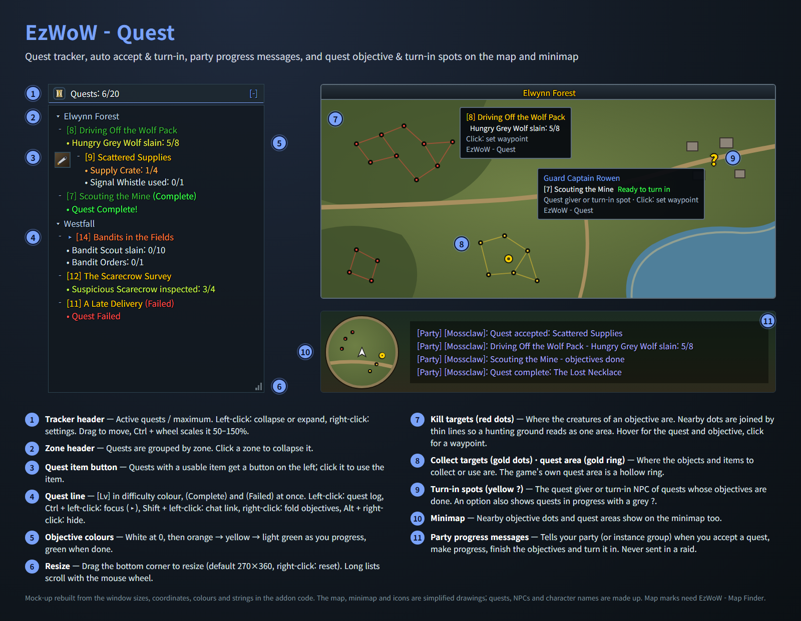
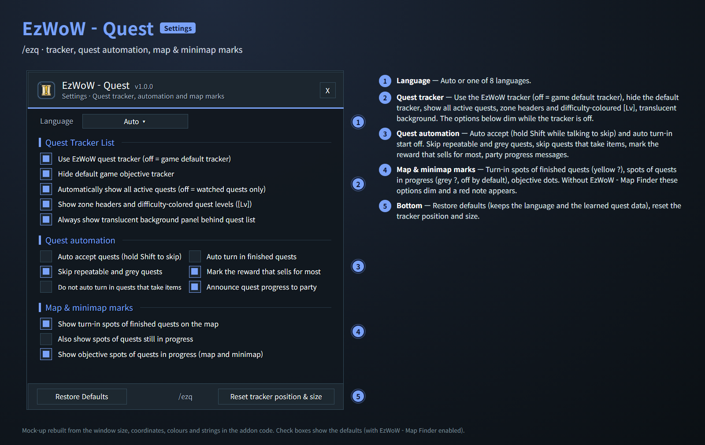
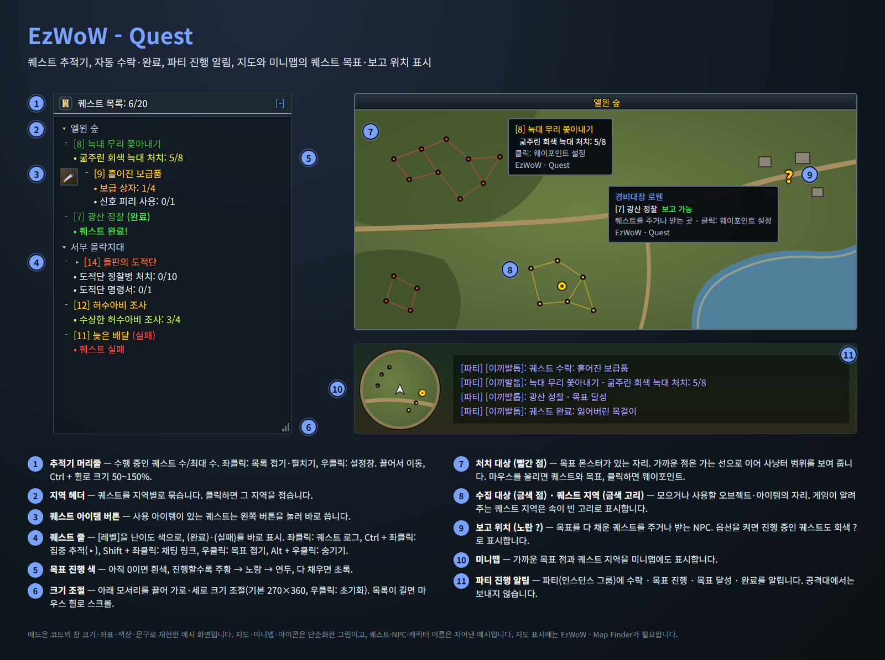
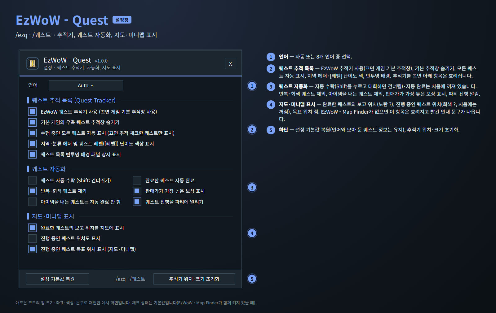

<!--
CurseForge summary (EN): Quest tracker, auto accept & turn-in, best reward mark, party progress messages, and quest objective & turn-in spots on the map and minimap.
CurseForge summary (KO): 퀘스트 추적기, 자동 수락·완료, 최고 보상 표시, 파티 진행 알림, 지도와 미니맵의 퀘스트 목표·보고 위치 표시.
-->

# EzWoW - Quest

**English** · [한국어](#한국어)

All quest features in one addon for WoW Forever: a scrollable quest tracker, auto accept and turn-in, a mark on the best-selling reward, party progress messages, and quest objective and turn-in spots on the World Map and minimap.

*Mock-ups rebuilt from the window sizes, coordinates, colours and strings in the addon code. Quests and names are made up.*

## Features

### Quest tracker
- Replaces the default objective tracker (can be switched back in the settings).
- Quests grouped by zone, with difficulty-coloured `[Lv]` and `(Complete)` / `(Failed)` at once.
- Objectives change colour as you progress: white → orange → yellow → green.
- Quests with a usable item get an item button you can click directly.
- Drag to move, Ctrl + mouse wheel to scale (50–150%), drag the bottom corner to resize, mouse wheel to scroll.
- Left-click a quest: quest log · Ctrl + left-click: focus · Shift + left-click: chat link · right-click: fold objectives · Alt + right-click: hide.

### Quest automation (off by default)
- Auto accept quests, including shared and escort quest confirmations. Hold **Shift** while talking to skip.
- Auto turn in finished quests. You still choose rewards yourself; quests that cost gold are never turned in.
- Options to skip repeatable and grey quests, and quests that take items.
- A gold mark on the reward that sells for most.

### Party progress messages
- Tells your party (or instance group) when you accept a quest, make progress, finish the objectives and turn it in. Never sent in a raid.

### Map and minimap marks (needs EzWoW - Map Finder)
- **Red dots**: creatures to kill. Nearby dots are joined by thin lines, so a hunting ground reads as one area.
- **Gold dots**: objects and items to collect or use. **Hollow gold ring**: the game's own quest area.
- **Yellow `?`**: where to turn in quests whose objectives are done (grey `?` for quests in progress, optional).
- Nearby dots also show on the minimap. Hover for the quest and objective, click to set a waypoint.

## Working with other EzWoW addons
- The quest features of **EzWoW - Frame Mover** and **EzWoW - Map Finder** moved to this addon. While it is enabled, their quest features turn off and this addon takes over.
- Their quest settings are carried over once, on the first start.
- The map and minimap marks use the location data of **EzWoW - Map Finder**; the tracker, automation and party messages work on their own.

## Commands
- `/ezq` or `/퀘스트` — open the settings
- `/ezq reset` — reset the tracker position and size
- `/ezq help` — list the commands

Languages: English, 한국어, Deutsch, Français, Español, Русский, 简体中文, 繁體中文.

---

## 한국어

WoW Forever용 퀘스트 기능을 한곳에 모은 애드온입니다. 스크롤형 퀘스트 추적기, 자동 수락·완료, 판매가가 가장 높은 보상 표시, 파티 진행 알림, 월드맵과 미니맵의 퀘스트 목표·보고 위치 표시를 제공합니다.

*애드온 코드의 창 크기·좌표·색상·문구로 재현한 예시 화면입니다. 퀘스트와 이름은 지어낸 예시입니다.*

## 기능

### 퀘스트 추적기
- 기본 퀘스트 추적창 대신 사용합니다(설정에서 기본 추적창으로 되돌릴 수 있음).
- 퀘스트를 지역별로 묶고 `[레벨]`을 난이도 색으로, `(완료)`·`(실패)`를 바로 표시합니다.
- 목표 진행에 따라 색이 바뀝니다: 흰색 → 주황 → 노랑 → 초록.
- 사용 아이템이 있는 퀘스트는 아이템 버튼을 눌러 바로 씁니다.
- 끌어서 이동, Ctrl + 마우스 휠로 크기(50~150%), 아래 모서리를 끌어 가로·세로 크기 조절, 마우스 휠로 스크롤.
- 퀘스트 좌클릭: 퀘스트 로그 · Ctrl + 좌클릭: 집중 추적 · Shift + 좌클릭: 채팅 링크 · 우클릭: 목표 접기 · Alt + 우클릭: 숨기기.

### 퀘스트 자동화 (처음에는 꺼짐)
- 퀘스트 자동 수락(공유·호위 퀘스트 확인 포함). 대화할 때 **Shift**를 누르고 있으면 건너뜁니다.
- 완료한 퀘스트 자동 완료. 보상은 직접 고르고, 골드를 내는 퀘스트는 완료하지 않습니다.
- 반복·회색 퀘스트, 아이템을 내는 퀘스트를 제외하는 옵션.
- 판매가가 가장 높은 보상에 금화 표시.

### 파티 진행 알림
- 파티(인스턴스 그룹)에 퀘스트 수락·목표 진행·목표 달성·완료를 알립니다. 공격대에서는 보내지 않습니다.

### 지도·미니맵 표시 (EzWoW - Map Finder 필요)
- **빨간 점**: 처치할 몬스터. 가까운 점은 가는 선으로 이어 사냥터 범위를 보여 줍니다.
- **금색 점**: 모으거나 사용할 오브젝트·아이템. **속이 빈 금색 고리**: 게임이 알려 주는 퀘스트 지역.
- **노란 `?`**: 목표를 다 채운 퀘스트의 보고 위치(옵션을 켜면 진행 중인 퀘스트는 회색 `?`).
- 가까운 점은 미니맵에도 표시합니다. 마우스를 올리면 퀘스트와 목표, 클릭하면 웨이포인트.

## 다른 EzWoW 애드온과 함께 쓰기
- **EzWoW - Frame Mover**와 **EzWoW - Map Finder**의 퀘스트 기능이 이 애드온으로 옮겨 왔습니다. 이 애드온이 켜져 있으면 두 애드온의 퀘스트 기능은 꺼지고 이 애드온이 맡습니다.
- 처음 실행할 때 두 애드온의 퀘스트 설정을 한 번 가져옵니다.
- 지도·미니맵 표시는 **EzWoW - Map Finder**의 위치 정보를 씁니다. 추적기·자동화·파티 알림은 이 애드온만으로 동작합니다.

## 명령어
- `/ezq` 또는 `/퀘스트` — 설정창 열기
- `/ezq reset` (`/퀘스트 초기화`) — 추적기 위치·크기 초기화
- `/ezq help` (`/퀘스트 도움말`) — 명령어 안내

지원 언어: English, 한국어, Deutsch, Français, Español, Русский, 简体中文, 繁體中文.
